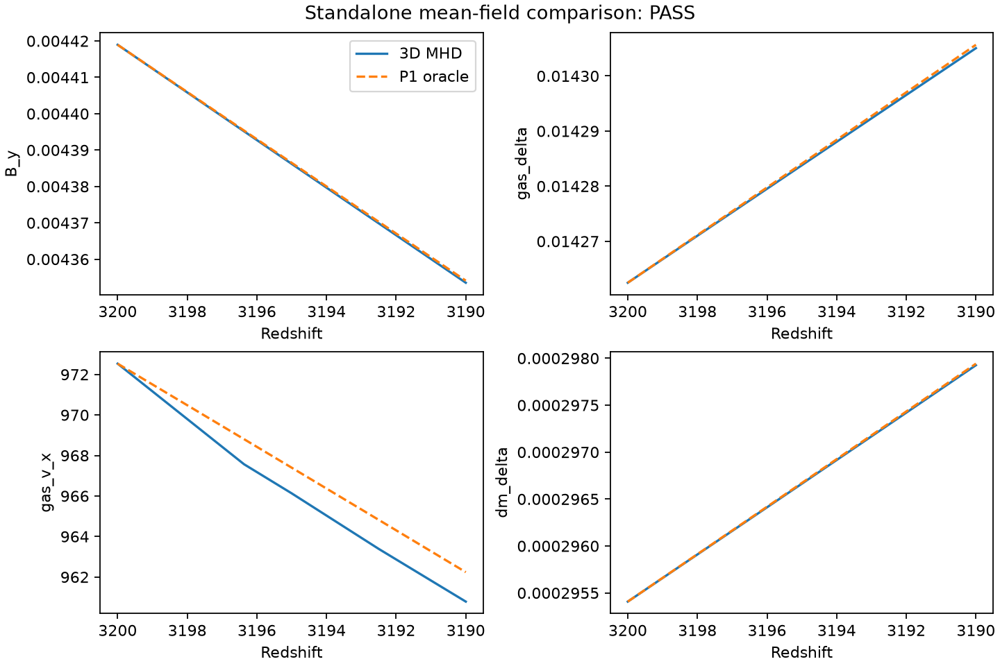

## Run the tests {#sec-run-tests}

```sh
julia --project=. -t auto test/runtests.jl
julia --project=. -t auto scripts/validate.jl --backend=cpu
```

The first runs tests directly in the active root with its bundled `[sources]`.
The second captures the same run in machine-readable evidence and logs under
`docs/data`. It requires Python 3 in addition to Julia. Do not rely on a
`Pkg.test()` sandbox to inherit active-root path sources.



GPU evidence must be collected on the hardware in its optional environment:

```sh
julia --project=environments/metal -t auto scripts/validate.jl --backend=metal
julia --project=environments/cuda -t auto scripts/validate.jl --backend=cuda
```

Run only the applicable command on a functional device. The underlying GPU gate
is `scripts/test_gpu.jl --backend=metal|cuda`; source inspection or compilation
on a device-less host is not an equivalent result.

The [results page](test-results.qmd) distinguishes `PASS`, `FAIL`, `NOT_RUN`,
and absent evidence. Assertions are checks in a particular suite, not the
number of independent scientific experiments or a fractional confidence score.

## What the suites address {#sec-test-map}

| Layer | Test source | What it can establish |
|---|---|---|
| Facade | `test/test_configuration.jl` | Configuration validation, units, deterministic options |
| Gravity | `test/test_gravity.jl` | Periodic Poisson/particle operators on controlled inputs |
| MHD | `test/inherited/runtests.jl` | Exact-wave behavior, conservation/convergence and solver regressions |
| Drag and photons | `test/inherited/test_drag_godunov.jl`, `test_radiation_coupling.jl` | Controlled source response, asymptotic limits, persistent photon fields |
| Species and recombination | `test_passive_transport.jl`, `test_recombination_mixing.jl`, `test_recombination_transport.jl` | Bounded transport and specified chemistry/reference cases |
| GPU | `test/test_backends.jl` | Available backend operators/parity; read actual coverage before generalizing |
| Python | `test/python` | Independent reference models, phase/unit contracts, TSV analysis |




An inherited test becomes **current evidence only when executed in this
extraction**. A unit test passing on CPU does not automatically establish GPU
correctness or long-run stability. Historical upstream descriptions are useful
for planning but their timing and certification numbers are not transplanted.

## Required science matrix {#sec-science-matrix}

Before publishing a physical UV band or recombination effect:

1. **Temporal:** halve the timestep at fixed ICs and compare at exactly common
   epochs. Include source cadence, chemistry half-steps and iteration caps, and
   free-streaming tolerance.
2. **Spatial:** keep the physical cutoff and realization fixed while increasing
   grid resolution. Compare force spectra as well as magnetic and density fields.
3. **Spectral:** extend cumulative UV bands with identical low-k phases and
   amplitudes; compare overlap intervals without renormalizing the low band.
4. **Start redshift:** use progressively earlier matched starts at common final
   epochs. A direct initialized field has no automatically supplied prehistory.
5. **Chemistry:** converge the network, smoothing length, thermal response,
   table support/interpolation, and hydrogen/helium electron contributions.
6. **Backend/precision:** compare CPU-f32, a CPU-f64 reference where applicable,
   and the actual GPU. Inspect density/thermal/phase floors, not just total RMS.
7. **Energy/divergence:** report positivity, `divB*dx/Brms`, sampled energy
   changes, and photon perturbation energy with the closure's unresolved losses.
8. **Restart:** compare a continuous trajectory to an equivalent split/resumed
   run, preserving configuration and source identity.

Choose observable-specific tolerances and signal floors **before** comparison.
RMS agreement alone can conceal phase error, ultraviolet redistribution,
wrong clocks, or pressure/tension cancellation.

### Define a serialized suite

```sh
julia --project=. -t auto scripts/run_suite.jl examples/convergence-suite.toml
# After reviewing its cases and expected cost:
julia --project=. -t auto scripts/run_suite.jl examples/convergence-suite.toml --execute
```

Without `--execute`, the suite command validates cases and prints their output
locations without evolving them. Cases override tables in a shared base config
and run serially when executed, avoiding simultaneous GPU/memory contention.
Select a GPU in the base/case `run.backend` and activate its environment.


The supplied suite is a starting definition, **not a completed convergence
study**. It keeps Gaussian smoothing at the same physical length by using four
cells at N64 and eight cells at N128. Review physical wavelength support,
projection cadence, and identical output epochs as grids change. Inspect `COMPLETED`
versus `STOPPED_AT_LIMIT` for every case before comparing histories.

## Comparing CT and GLM runs {#sec-ct-vs-glm}

`examples/cosmology-smoke-ct.toml` is the CT counterpart of
`examples/cosmology-smoke.toml`; to compare any case, keep the TOML identical
except `run.mhd_solver`, and give each run a new output directory. Expected,
documented differences are not discrepancies to fit away:

- The default GLM radiation path projects `B` every cycle and limits the
  explicit step by `ch = glm_ch_fac * smax`. CT does neither, so at equal `cfl`
  its explicit step is the plain CFL step. Whether this matters depends on
  whether the CFL step or a cosmological/source cap sets `dt`; the smoke
  problem is capped by `max_dln_a`, where both solvers take identical steps.
  `metadata.toml` records `ct_step_glm_limited = false` and `ct_glm_project_every = 0`.
- CT builds its faces from the initial cell field, which changes that field by
  O((k dx)^2) near the cutoff. Report the `CT_INITIAL_FACES` numbers
  (`metadata.toml: ct_initial_*`). Using `curl_symbol = "continuum"` reduces the
  change for Batchelor fields. The first history row of a CT run therefore
  differs from GLM's at the level of that change, not at Float32 round-off.
- Compare actual common redshifts from the `z` columns, not cycle numbers, and
  compare `divb_face_dx_over_brms` (CT, Float32 round-off) with the centred
  `divBdx_over_brms` (GLM). The centred value of a CT run is not constrained to zero.
- The remaining agreement criteria are those of the
  [science matrix](#sec-science-matrix): define tolerances before measuring, and
  refine timestep and grid separately for each solver. CT runs on the CPU
  backend only: Metal fails to compile the CT kernel (38 of 31 buffer
  arguments) and CUDA is `NOT_RUN`.

## Float32 and thermal floors {#sec-thermal-floors}

The total-energy formulation reconstructs thermal energy by subtracting kinetic
and magnetic energy. Float32 cancellation can erase small thermal/chemical
perturbations or make floors dominate while the total state remains finite.
An internal-energy or temperature curve pinned to a floor is not a converged
recombination prediction.

Check `p_min`, `eint_min`, `temperature_min`, all corresponding means/maxima,
and sensitivity to `MHD_PFLOOR`, velocity units, field normalization, timestep,
and CPU precision. A larger floor or more diffusive fallback can stabilize a
run while changing its science. Record it explicitly.

Guide-field compensated magnetic increments preserve updates below a Float32
field ULP; they do not fix every energy subtraction or photon-density roundoff
problem. Tiny density contrasts can be near diagnostic precision even when
magnetic divergence is small. Compare complex modes and expected signal size.

## Model limitations {#sec-limitations}

**Photon P1.** The four evolved photon fields and algebraic stress closure are
not a full angular/polarization hierarchy. Tight/free asymptotic agreement
does not establish transfer accuracy throughout `k*lambda_gamma`. Compare
matched modes to higher-hierarchy references and converge that reference too.

**Lyman-alpha.** Gaussian mixing is a smoothing model, not line transport.
`MHD_CHEM_NONLOCAL_TABLE` is an explicitly supplied response table with a finite
redshift/wavenumber domain. It requires `MHD_CHEM_FALPHA=0` and
`MHD_CHEM_SMOOTH=local` to avoid double-counting. Inspect interpolation and
out-of-support behavior. Perturbative tables do not certify strongly nonlinear
inhomogeneous recombination.


**Thermal sources.** Temperature response, subtraction precision, species
storage, and the chosen helium/electron model affect recombination and drag.
An unchanged average ionization history is not evidence that spatial thermal
responses are correct.

**Terminal approximations.** Terminal/hybrid modes are retained for legacy
comparison, require explicit opt-in, and did not earn automatic production
status from this extraction. Full-MHD radiation is the public research path.

**Reference versus nonlinear solver.** Python Schiff/LMHD, photon P1, and
Lyman-alpha hierarchy tools are independent controlled models. They do not run
the full 3D Julia system. A reference-only handoff, a plotted paper curve, or a
matching one-zone history is not a reproduction of all Schiff full-3D results.

## Python reference checks {#sec-python-validation}

### End-to-end native MHD comparison

```sh
uv sync --extra test
uv run pmf-compare-nonlinear results/native-mode-metal --backend=metal \
  --resolution=32 --zend=3190 --outputs=5 --execute
```

This command executes the actual standalone Julia driver from a correlated
photon-P1 handoff. It writes the resolved TOML, production log/tables,
`comparison.tsv`, `gate.json`, and PDF/PNG overlays. The independent P1 model
starts from the actual jointly transferred modes without fitting the evolved
amplitudes. The comparison retains physical peculiar velocities and complex
phase; reference and production source hashes accompany its gate.



The default z=3200 to 3100 interval is a small controlled test. The command
above shortens it further for installation verification. Select z=500 and N64
or higher for through-recombination work, then converge CFL, spatial resolution,
source history, and optional nonlocal response table. The default uses full
local chemistry, including expansion and helium. `--response-table` supplies
the same nonlocal response to all three stages. The reduced oracle's
hydrogen/thermal closure differs from full H/He evolution; early xHII and thermal
perturbations remain explicit model comparisons.

The supplied N32 Metal run uses a 300 pG comoving guide field, perturbation
fraction 0.025, and a 1 ckpc/h box. Its 36 resolved evolved observables pass the
5% amplitude and 0.03-radian phase gates over z=3200 to 3190; the measured worst
errors are 0.201% and 2.20e-6 radians. The code, solver/reference hashes, and
actual configuration are in the [gate](data/native-mode-metal/gate.json),
[complex-mode table](data/native-mode-metal/comparison.tsv),
[handoff metadata](data/native-mode-metal/handoff-metadata.json), and
[run metadata](data/native-mode-metal/run-metadata.toml). This short test's
amplitudes are large enough for Float32 comparison. It does not replace a
through-recombination spatial/temporal convergence study.

{#fig-native-mode fig-alt="Four panels overlay the actual Metal and independent P1 magnetic, baryon density, velocity, and dark matter Fourier amplitudes from redshift 3200 to 3190."}

[Download the vector comparison figure](data/native-mode-metal/comparison.pdf).
The matched threaded-CPU run also passes, with 0.201% maximum amplitude error:
[CPU gate](data/native-mode-cpu/gate.json) and
[CPU raw comparisons](data/native-mode-cpu/comparison.tsv).

### Independent small demo

{#fig-reference-demo fig-alt="Three panels compare two independent linear closures: normalized magnetic perturbation, baryon density-contrast amplitude, and parallel peculiar velocity in cm/s versus redshift."}

This supplied reference calculation uses `k=1000` comoving Mpc^-1 (no h),
`B0=3e-11 G` comoving (**30 pG**, distinct from the 3 pG Julia example),
`theta=pi/4`, and perturbation fraction `1e-4`. Its background is fully ionized
hydrogen with no helium electrons, gravity, or evolving baryon-temperature
perturbation. The two closures are distinct models, not trajectories required
to agree for every mode or epoch. The plotted magnetic axis uses an offset
near one; density perturbations here are extremely small.

[Reference data and parameters](data/reference-demo/reference.json) and
[vector PDF](data/reference-demo/lmhd_p1.pdf) accompany the figure. No conclusion
about nonlinear 3D convergence, Lyman-alpha transfer, or GPU parity follows
from this demo.

```sh
uv sync --extra test
uv run python -m unittest discover -s test/python -v
uv run pmf-reference results/reference
uv run pmf-matched-scenario results/matched
```

These generate compact reference artifacts and plots. `matched_scenario`
labels its output `REFERENCE_ONLY`; its NPZ is not a native Julia checkpoint.
To compare an evolved candidate, preserve the same complex Fourier convention,
units, polarization, epochs, and field names. Read `tools/README.md` for handoff
generators and strict comparison commands. The native nonlinear hierarchy
campaign and private/external paper data are not bundled certification.

## Streaming and planar regression scope {#sec-streaming-validation}

The streaming extensions are controlled capabilities, not a completed
Tseliakhovich–Hirata cosmological reproduction. The independent matter-era ODE
checks exact pressureless growth, transverse-stream invariance, conjugate phases
under velocity reversal, and suppression in a declared short-mode example.
The shared CPU/device tests check a common physical boost, periodic sampling at
moved particles, all three components, and planar MHD invariance.



The production validator retains its full-physics endpoint smoke and adds a
four-cycle planar streaming restart control and sparse/frequent diagnostic
comparison. It checks the actual physical-box wavenumber, initial velocity sign
and units, and coupled planar invariance with a `5e-6` scaled tolerance. These
cycle-limited trajectories are deliberately `STOPPED_AT_LIMIT`; their restart
comparison is not an endpoint or long-time physical convergence result.


During this audit, the coupled planar gate exposed a pre-existing diagnostic
side effect: inverse-transforming the live photon Fourier state modified its
input on FFTW. Diagnostics now copy photon modes to reusable FFT scratch before
inversion. Tests assert that photon modes are unchanged by reading maps and
that subsequent coherent-flow evolution agrees with a run that did not read them.
The production cadence comparison checks this through the coupled driver.


Planar initial conditions still use the full cube, and a constant imposed stream
does not generate correlated primordial gas/DM transfer initial conditions.
Eulerian relative-velocity spectra with an explicit multistream/empty-cell
estimator, a cosmological transfer generator, long-interval matched streaming
validation, and a reduced-memory planar coupled backend remain outside this
validation scope. Use [the streaming conventions](physics.qmd#sec-streaming)
and [the output workflow](outputs.qmd#sec-streaming-output) when designing a study.
